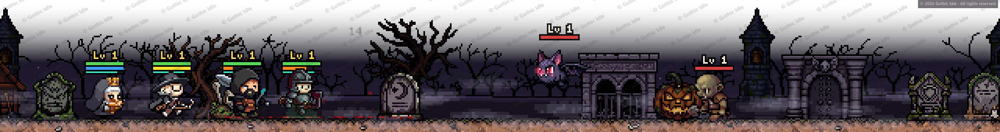
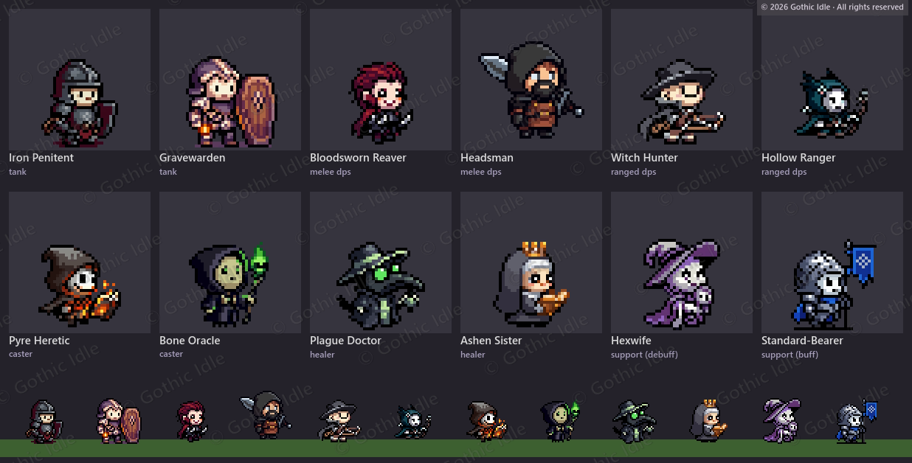

# Gothic Idle (working title)

A small idle RPG that lives in a thin strip above your Windows taskbar. A party of chibi heroes walks through dark gothic lands and fights while you work. You glance down now and then. Something is usually on fire.

## The idea

- Pick a party of four from twelve heroes, each with their own spells and a role to play.
- Send them out. They fight on their own, level up, find gear and push deeper.
- Dark gothic pixel art, friendly faces, rain, mist, lightning and candlelight.
- Some places, creatures and events are meant to be found, not read about. This devlog shows the craft and keeps the surprises.

## Follow along

Short notes on how the game is coming together are in [updates/](updates/). New ones appear every week or two.

## How it's made

- **Engine:** Godot 4
- **Art:** pixel art generated with [PixelLab](https://pixellab.ai), then picked, fixed and animated by hand
- **Code:** built together with [Claude Code](https://claude.com/claude-code)

The game's source code isn't public.

## License

All artwork and text here © 2026 Gothic Idle. All rights reserved. See [LICENSE](LICENSE). Sharing screenshots and cards from this repo is welcome as long as you credit "Gothic Idle" and link back here.
