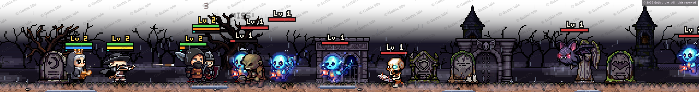

# Welcome to the devlog

*November 2, 2026*

Gothic Idle is a tiny RPG that walks along the top of your taskbar while you do something else. This is where I'll share how it's coming together.

A few things you can expect from here:

- Pixel art, from first sketch to finished animation.
- How the heroes, the weather and the mist are built.
- Hints about what's lurking further down the road.

Today's tease: **it rains now.** The rain is more than decoration, and the heroes will learn that the hard way.

More soon.
